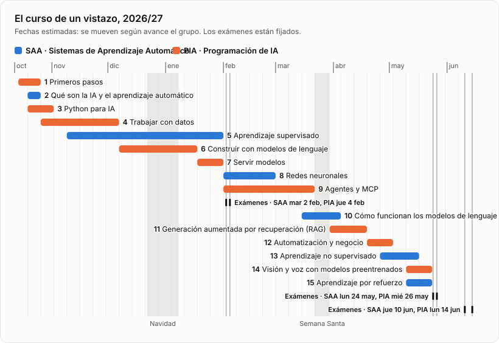

# Inteligencia Artificial 2026/27

> 🇪🇸 **Traducción al español** del repositorio original de [avidaldo/ai](https://github.com/avidaldo/ai) hasta el commit a115b4448419295f8012094bd3a7e9c19dcf833b, hecha por un alumno para ayudar a los compañeros. La versión de referencia es siempre la original en inglés: si algo no cuadra, consúltala.

Materiales de dos módulos del curso de especialización en Inteligencia Artificial y Big Data, impartidos juntos como un único itinerario:

- **SAA · Sistemas de Aprendizaje Automático**: cómo aprenden los modelos a partir de los datos, cómo se entrenan y cómo saber si de verdad funcionan.
- **PIA · Programación de Inteligencia Artificial**: construir software con IA: Python y sus herramientas, modelos de lenguaje, recuperación de información, agentes, despliegue y automatización.

## Hoja de ruta

El curso en quince etapas. El gráfico y la última columna de la tabla estiman cuándo trabaja el grupo cada una: guíate por esas fechas más que por los números de etapa, porque las etapas de los dos módulos se solapan. **Las fechas son estimaciones, no plazos.** Solo los exámenes están fijados: las demás fechas se mueven según avance el grupo, el trabajo de cada semana se presenta en la sesión semanal y todo cambio se hace en esta página. Los materiales suelen publicarse mucho antes de que se necesiten, y siempre puedes adelantarte. Si un ejercicio te lleva más tiempo, como puede pasarte con numpy-mnist si eres nuevo en la programación, termínalo con tu asistente de programación con IA, asegúrate de entender cada línea que escribe y sigue con el grupo: la siguiente etapa no espera.

Cada etapa pertenece a un módulo: si solo cursas uno, sigue sus filas, más dos del otro. La etapa 6 de PIA necesita la nota de SAA [Los modelos de lenguaje vistos desde fuera](saa/concepts/background/language_models.md), de la etapa 2, y la etapa 11 de PIA necesita la etapa 10 de SAA. Los elementos marcados como *(próximamente)* se están escribiendo y se enlazarán cuando estén listos.
  
<table>
<thead>
<tr><th colspan="5" align="left">🟦 SAA · Sistemas de Aprendizaje Automático &emsp; 🟧 PIA · Programación de Inteligencia Artificial</th></tr>
<tr>
    <th align="right">#</th><th align="left">Etapa</th><th align="left">Tema</th><th align="left">Ejemplos resueltos</th><th align="left">Fechas estimadas</th>
</tr>
</thead>
<tbody>

<tr><th colspan="5"></th></tr>
<tr><th colspan="5" align="left">Primer trimestre</th></tr>
<tr><th colspan="5"></th></tr>
<tr><td align="right">1</td><td>🟧 Primeros pasos</td><td><a href="pia/setup/README.md">Preparar el entorno</a>: tus herramientas, tu fork de numpy-mnist y tu usuario de GitHub en el aula virtual</td><td></td><td nowrap>14–25 oct</td></tr>
<tr><td align="right">2</td><td>🟦 Qué son la IA y el aprendizaje automático</td><td><a href="saa/concepts/README.md">El mapa del curso</a>: cada familia de modelos, vista desde fuera</td><td></td><td nowrap>19–25 oct</td></tr>
<tr><td align="right">3</td><td>🟧 Python para IA</td><td><a href="pia/setup/why_python.md">Por qué Python domina la IA</a>, aunque sea lento</td><td><a href="https://github.com/avidaldo/python-tic-tac-toe">Tres en raya</a>, sobre la estructura de un programa, recomendado</td><td nowrap>19 oct – 1 nov</td></tr>
<tr><td align="right">4</td><td>🟧 Trabajar con datos</td><td><a href="pia/python-data-essentials/README.md">Lo esencial de Python para datos</a>: NumPy y pandas, los problemas de una tabla, datos de APIs web</td><td>Los ejercicios de <a href="https://github.com/avidaldo/numpy-mnist">numpy-mnist</a></td><td nowrap>26 oct – 6 dic</td></tr>
<tr><td align="right">5</td><td>🟦 Aprendizaje supervisado</td><td><a href="saa/supervised-learning/README.md">Aprendizaje supervisado</a>: regresión, clasificación y cómo saber si un modelo de verdad funciona; <a href="saa/data-preparation/README.md">Preparación de datos</a> tras su parte 3</td><td><a href="https://github.com/avidaldo/king-county">Ventas de casas en King County</a>, <a href="https://github.com/avidaldo/california_e2e">viviendas de California</a>, <a href="https://github.com/avidaldo/thyroid">enfermedad de tiroides</a></td><td nowrap>9 nov – 31 ene</td></tr>
<tr><td align="right">6</td><td>🟧 Construir con modelos de lenguaje</td><td>Modelos locales y remotos, prompts, salida estructurada, probar un componente que usa un modelo <em>(próximamente)</em></td><td><a href="https://github.com/avidaldo/ai-chat-guardrails">Un chatbot con salvaguardas</a></td><td nowrap>7 dic – 17 ene</td></tr>
<tr><td></td><td colspan="3"><em>Navidad</em></td><td nowrap><em>22 dic – 7 ene</em></td></tr>
<tr><td align="right">7</td><td>🟧 Servir modelos</td><td>Un modelo detrás de una API web y una demo, en un contenedor, desplegado <em>(próximamente)</em></td><td><a href="https://github.com/avidaldo/cifar-10-fastapi">Un clasificador de imágenes servido con FastAPI</a>, y <a href="https://huggingface.co/spaces/avidaldo/cifar-10-fastapi-gradio">el mismo como app de Gradio</a></td><td nowrap>18–31 ene</td></tr>
<tr><th colspan="5"></th></tr>
<tr><td></td><td><b>Exámenes de febrero</b></td><td>Primer trimestre (etapas 1–7)</td><td></td><td nowrap>🟦 SAA <b>mar 2 feb</b> 🟧 PIA <b>jue 4 feb</b></td></tr>

<tr><th colspan="5"></th></tr>
<tr><th colspan="5" align="left">Segundo trimestre</th></tr>
<tr><th colspan="5"></th></tr>
<tr><td align="right">8</td><td>🟦 Redes neuronales</td><td>Cómo aprende una red, redes para tablas, redes convolucionales, reutilizar una red preentrenada <em>(próximamente)</em></td><td></td><td nowrap>1–28 feb</td></tr>
<tr><td align="right">9</td><td>🟧 Agentes y MCP</td><td>Llamadas a herramientas (<em>tool calling</em>), agentes que usan herramientas de forma segura, y MCP, una forma estándar de conectar modelos con herramientas <em>(próximamente)</em></td><td></td><td nowrap>1 feb – 21 mar</td></tr>
<tr><td align="right">10</td><td>🟦 Cómo funcionan los modelos de lenguaje</td><td>De las palabras como recuentos a los <em>embeddings</em>, la atención y los <em>transformers</em> <em>(próximamente)</em></td><td></td><td nowrap>15 mar – 4 abr</td></tr>
<tr><td></td><td colspan="3"><em>Semana Santa</em></td><td nowrap><em>22–29 mar</em></td></tr>
<tr><td align="right">11</td><td>🟧 Generación aumentada por recuperación (RAG)</td><td>Respuestas de un modelo basadas en tus propios documentos, citando sus fuentes <em>(próximamente)</em></td><td></td><td nowrap>30 mar – 18 abr</td></tr>
<tr><td align="right">12</td><td>🟧 Automatización y negocio</td><td>Sistemas de IA que funcionan solos, y si merecen la pena <em>(próximamente)</em></td><td></td><td nowrap>19 abr – 2 may</td></tr>
<tr><td align="right">13</td><td>🟦 Aprendizaje no supervisado</td><td><em>Clustering</em>, reducción de dimensionalidad y detección de anomalías <em>(próximamente)</em></td><td></td><td nowrap>26 abr – 16 may</td></tr>
<tr><td align="right">14</td><td>🟧 Visión y voz con modelos preentrenados</td><td><a href="https://github.com/avidaldo/computer-vision">Visión por computador</a>: OpenCV, YOLO, <em>embeddings</em> CLIP y una app de autenticación facial. Voz: de voz a texto y de texto a voz <em>(próximamente)</em></td><td></td><td nowrap>10–23 may</td></tr>
<tr><td align="right">15</td><td>🟦 Aprendizaje por refuerzo</td><td><a href="saa/reinforcement-learning/README.md">Aprender de las recompensas</a>: agentes, entornos y Q-learning</td><td><a href="https://github.com/avidaldo/tictactoe-qlearning">Tres en raya con Q-learning</a></td><td nowrap>10–23 may</td></tr>
<tr><th colspan="5"></th></tr>
<tr><td></td><td><b>Exámenes de mayo</b></td><td>Todo el curso (etapas 1–15)</td><td></td><td nowrap>🟦 SAA <b>lun 24 may</b> 🟧 PIA <b>mié 26 may</b></td></tr>
<tr><th colspan="5"></th></tr>
<tr><td></td><td><b>Exámenes de junio</b></td><td>Todo el curso (etapas 1–15)</td><td></td><td nowrap>🟦 SAA <b>jue 10 jun</b> 🟧 PIA <b>lun 14 jun</b></td></tr>
</tbody>
</table>
  

<picture>
  <source media="(prefers-color-scheme: dark)" srcset="course/roadmap-dark.svg">
  
</picture>

## Cómo trabajar

1. **Sigue la [hoja de ruta](#hoja-de-ruta)** según sus fechas estimadas, desde la etapa 1, que prepara tus herramientas. Cada etapa tiene un tema: abre su README y recorre su itinerario en orden. Ejecuta `git pull` para recibir cada tema según se publica.
2. **Dedica unas 10 horas a la semana** a los dos módulos, la sesión semanal incluida; se alternan por bloques. Si tienes menos tiempo, haz primero los elementos básicos (★) y sigue los proyectos, construyéndolos o bien leyendo, ejecutando y modificando la solución del profesor; vuelve al resto cuando puedas. Los elementos sin marcar son el resto del itinerario, y el cuestionario también pregunta por ellos. Las profundizaciones son opcionales y nunca se evalúan: el README de cada tema las enumera después de su itinerario, con el elemento que cada una amplía.
3. **Practica.** Leer y ejecutar no basta: construye los proyectos de más abajo y prueba las tareas de práctica que proponen algunos temas y ejemplos resueltos. La práctica nunca se califica, y es la mejor preparación para los exámenes.

## Los proyectos

Repositorios públicos de los que haces fork y que vas desarrollando a lo largo del curso, paso a paso. Pueden añadirse más según avance el año.

| Proyecto | Módulo | Qué construyes | Empieza |
| --- | --- | --- | --- |
| [numpy-mnist](https://github.com/avidaldo/numpy-mnist) | PIA | Imágenes como arrays de NumPy, con Git, tests e integración continua. Guarda tus soluciones: volverán más adelante en el curso | Haz fork en la etapa 1 y resuelve sus ejercicios en la etapa 4 |
| [Asistente de normativa](https://github.com/avidaldo/fp-regulations-assistant) | PIA | Un asistente que ayuda a un profesor a responder las preguntas del alumnado sobre la normativa de formación profesional, citando los artículos en vigor | Etapa 4 |
| [Valoración de viviendas](https://github.com/avidaldo/idealista18-avm) | SAA | Una estimación del precio de una vivienda a partir de anuncios reales, y de cuánto se puede confiar en cada estimación | Etapa 5 |

Los dos proyectos más grandes los construye todo el grupo, un paso cada vez:

- **Cada paso es una issue** en el repositorio del proyecto, con la comprobación que demuestra que está hecho. Haz allí tus preguntas.
- **Trabaja en tu fork**, y abre un pull request que enlace la issue del paso ([cómo](pia/setup/git_github.md#contribuir-con-un-pull-request)). Es tu entrega: recibe feedback y nunca se califica, aunque una vez aceptado cuenta como contribución.
- **La solución del profesor llega con la siguiente issue**, con los buenos pull requests fusionados en ella o en su lugar. Tráela a tu fork antes de empezar el siguiente paso ([cómo](pia/setup/git_github.md#mantener-tu-fork-al-día)).

La parte práctica de cada examen trabaja sobre estos repositorios.

## Exámenes y tu nota

Cada módulo se califica por separado, a partir de exámenes presenciales. Febrero cubre el primer trimestre: es un ensayo obligatorio, y puede subir tu nota, nunca bajarla. Mayo cubre todo el curso y da tu nota, y junio es una segunda oportunidad. Cada examen tiene un cuestionario y una parte práctica sobre los proyectos. Las contribuciones aceptadas pueden sumar hasta 2 puntos a un módulo aprobado. Fechas y reglas: [Cómo se te evalúa](course/assessment.md).

## Mejorar los materiales

Si encuentras un error o algo poco claro, abre una issue; si puedes arreglarlo, envía un pull request. Cómo, y cómo cuentan las contribuciones: [Mejorar los materiales del curso](CONTRIBUTING.md).
