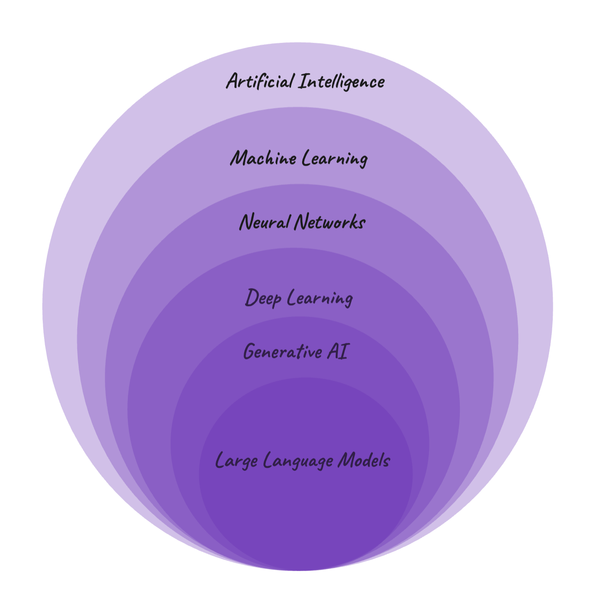

# Language Models from the Outside

A **language model** is a [neural network](neural_networks.md) trained to continue text. Chat assistants, the [AI coding assistant](../../../pia/setup/ai_assisted_development.md) in your editor and the language-model applications built in PIA all run on one. Seen from the outside, it does one thing again and again: it predicts the next piece of text. Almost everything a user notices, good and bad, follows from that and from how the model was trained. How it computes its predictions inside, with embeddings, attention and the transformer, is explained in the topic on how language models work *(coming)*.



*A common picture of where language models sit. It simplifies: some generative models are not deep networks, and some language models, such as BERT, fill in hidden words instead of continuing text, and generate nothing.*

## One Token at a Time

### Tokens

A language model doesn't read letters or words, but **tokens**: pieces of text from a fixed vocabulary. A program called a *tokenizer* builds that vocabulary before training, from a large sample of text: the pieces that appear most often become tokens. A frequent word is a single token, usually together with the space before it, and a rare word is split into several. Here is the same sentence in three languages, split by a real tokenizer (OpenAI's `o200k_base`, with about 200,000 tokens):

```text
Tokenization is unbelievably useful.      Token|ization| is| unbelievably| useful|.          6 tokens
La tokenización es increíblemente útil.   La| token|ización| es| increíble|mente| útil|.     8 tokens
A tokenización é incriblemente útil.      A| token|ización| é| in|crib|lement|e| útil|.      10 tokens
```

English needs the fewest tokens because the text that tokenizers are built from is mostly English. That matters because models are limited, and charged, by tokens: the same content in Spanish or Galician costs more of both.

### Predicting the Next Token

Given a text, the model computes, for every token in its vocabulary, the probability that it comes next. One token is chosen and appended, and the longer text goes back into the model to choose the following one. An answer is that step repeated, token after token, until the model chooses a special token that marks the end, or a length limit is reached. With made-up probabilities:

```text
The cat sat on the       →   mat 0.41   floor 0.18   sofa 0.09   …
The cat sat on the mat   →   . 0.52   and 0.21   , 0.08   …
```

Each token is chosen from the text so far, so an early mistake becomes part of the text the model continues from: a model that starts a wrong answer can carry on with it, and even justify it.

### Sampling and Temperature

The model doesn't always take the most likely token: it **samples**, picking at random with the predicted probabilities, so that *floor* comes out almost one time in five. That is why the same question can get different answers. A setting called **temperature** controls how much they vary. A low temperature makes the likely tokens even more likely, and the answers more repeatable; a high one flattens the probabilities, and the answers vary more. At temperature 0 the model always takes the most likely token, although a model served by a provider may still not give exactly the same answer every time.

## How a Language Model Is Made

A model's **parameters** are the numbers adjusted in training, and a **large language model** (LLM) has billions of them. Small ones, with a few billion, run on a laptop; the largest need the hardware of a data centre. A chat model is trained in three steps:

1. **Pretraining**, [self-supervised](machine_learning_paradigms.md#between-supervised-and-unsupervised): the model learns to predict the next token of real text (web pages, books, code), trillions of tokens of it. This step usually costs the most, weeks or months on thousands of GPUs, and it is where the model learns most of what it knows about language and the world. The result is a **base model**, which continues any text in the style of the text it was trained on.
2. **Instruction tuning**, supervised: the model is trained further on example conversations, each an instruction with a good answer, written by people or generated by other models. It learns the format of a conversation and the role of an assistant.
3. **Preference tuning**: people, and increasingly other models, compare answers to the same question, and the model is tuned to give the kind of answer that is preferred: more helpful, more honest, and refusing harmful requests. One way is [reinforcement learning from human feedback](machine_learning_paradigms.md#reinforcement-learning) (RLHF); other methods learn from the comparisons directly, without reinforcement learning.

> [!NOTE]
> **The same text, two models**
>
> Given *"What is the capital of France?"*, a base model may carry on with *"What is the capital of Germany? What is the capital of Italy?"*, as if it were completing a list of quiz questions: on the web, a question is often followed by more questions. A model tuned on conversations answers *"Paris."*

**Reasoning models** add a further step: reinforcement learning on problems whose answers can be checked automatically, such as maths and programming, with a reward for a correct final answer. They learn to write out a long chain of intermediate steps before they answer. This makes them better at such problems, and slower and more expensive, since those steps are tokens too.

The model keeps no copy of its training text to look things up: what it learned is spread across its parameters, although it can repeat word for word a passage it saw many times.

## What Follows from That

### Fluent Is Not the Same as True

The model was trained to produce likely text, not true text. When its training text said the same thing many times, the likely answer is usually right. When it didn't, the most likely continuation is still a fluent, confident answer: a reference to a paper that doesn't exist, an article of a law with the wrong number, a function that a library doesn't have. This is called **hallucination**. Training can make it rarer, by teaching models to say when they don't know, but doesn't remove it, and a wrong answer reads exactly like a right one. Check whatever matters, and design applications so that their answers can be checked.

### Its Knowledge Stops at a Date

What a model knows comes from text collected up to a date, its **knowledge cutoff**. Anything later, such as a new version of a library or a law amended last month, doesn't exist for the model unless the text is put in front of it.

### The Context Is All It Sees

In each call, the model sees only the text it is sent, its **context**: the instructions of the application (the *system prompt*), the conversation so far, and any documents. A conversation reaches it as one text, with markers for each role, and the model continues it from the assistant's turn. The context has a maximum length, the **context window**, counted in tokens and shared by the question and the answer: from a few thousand tokens in early models to hundreds of thousands, or more, today.

The model has no memory between calls. A chat application sends the whole conversation again with every message, and a *memory* feature saves notes and puts them back into the context. A longer context costs more and takes longer, and a detail in the middle of a very long one can be overlooked more easily than one at its start or end.

### It Sees Tokens, Not Letters

Because the model reads tokens, tasks about letters are harder for it than they look. Above, *unbelievably* is a single token: the model doesn't see its letters, so counting them, or spelling the word backwards, has to come from what it learned about that token. Exact arithmetic with long numbers is also error-prone. A program does both reliably, and a model can be given one as a tool.

### It Only Writes Text

A model can't search the web, run code, read your files or send an email: it only produces text. An application can give it **tools**: the model writes a request in an agreed format, a *tool call*; the application runs it and puts the result into the context; and the model continues. A coding assistant works this way: reading a file or running a command is a tool call that the assistant's program carries out, often after asking you. Agents, and MCP, a standard way to connect models to tools, are explained in the topic on agents and MCP *(coming)*.

### Answers Grounded in Documents

To answer about documents that a model never saw, or that changed after its cutoff, an application can find the passages that matter and put them in the context, with an instruction to answer only from them and to cite them. This is **retrieval-augmented generation** (RAG), explained in its own topic *(coming)*. It makes invented answers rarer, but doesn't rule them out: the model can still misread a passage or cite the wrong one, so the citations have to be checked against the source.

## Beyond Text

- **Multimodal models** take images, audio or video as input, turned into a sequence of tokens too, and some also produce them.
- **Embeddings:** a related kind of model turns a whole text into a list of numbers, a vector, so that texts with similar meanings get vectors close to each other. That is how applications search by meaning, and often how RAG finds its passages. How embeddings are learned is part of the topic on how language models work *(coming)*.
- **Open-weight and closed models:** some companies publish a model's weights, its learned parameters, so that anyone can download it and run it on their own computer, with a tool such as Ollama, without their data leaving it. Others can only be used through the company's API, paying per token. Open weights are not open source: the training data and code are usually not published, and the licence may restrict how the model is used. Calling both kinds is explained in the topic on building with language models *(coming)*.
