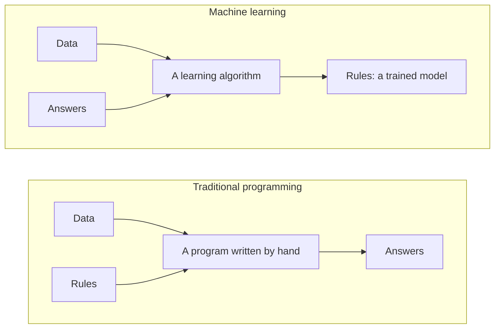
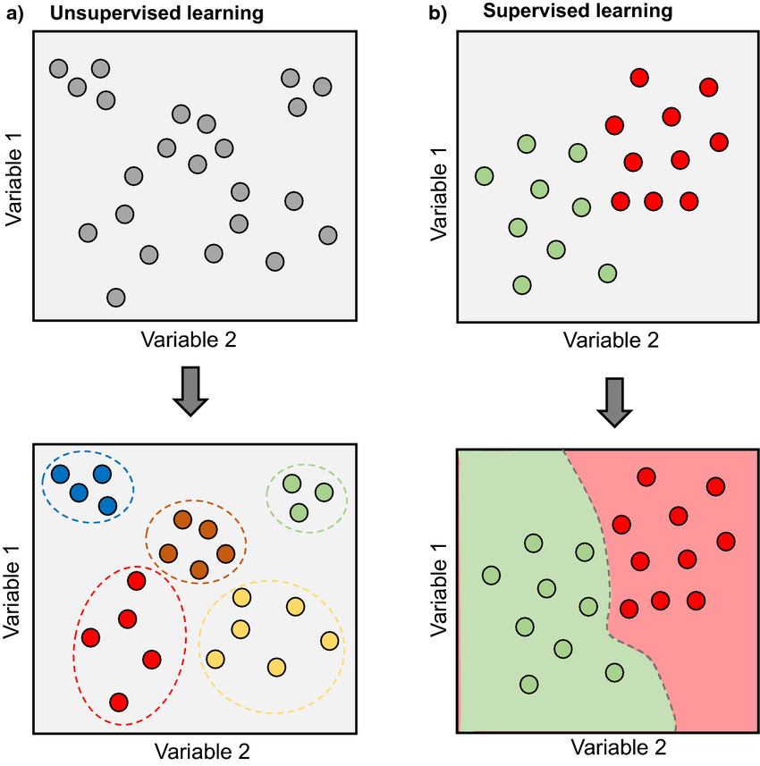

# Machine Learning Paradigms

Machine learning enables systems to learn from data, identify patterns, and make decisions with minimal human intervention. Unlike traditional programming, where programs are designed with explicit rules, ML builds models by learning from data.

> [Models to understand a chaotic reality | DotCSV](https://www.youtube.com/watch?v=Sb8XVheowVQ) (in Spanish)

A **model** is an abstract, articulated description of a reality. In machine learning, models are what we **train** with data using a learning algorithm. The model learns to adjust itself to a large number of examples and is then used to predict the correct response for new, unseen input data.

The vocabulary used all year:

- An **example** (also *instance* or *sample*) is one row of data: one house, one email, one image.
- Its **features** are the inputs the model sees: the house's area and location, the email's words, the image's pixels.
- The **target** (or *label*) is the answer to predict: the house's price, *spam* or *not spam*.
- The **parameters** are the numbers the learning algorithm adjusts during training, such as the weights of a linear model. The **hyperparameters** are the choices made before training, such as how deep a tree may grow.
- The **training set** is the data the model learns from; the **test set** is data kept apart to measure how well it does on examples it has never seen.
- **Inference** is using the trained model to predict for new examples.

The way a model learns is defined by its learning paradigm, which is classified based on the type of supervision or feedback it receives during training.

> [What is Supervised and Unsupervised Learning? | DotCSV](https://www.youtube.com/watch?v=oT3arRRB2Cw) (in Spanish)

The two most common paradigms, crossed with the kind of output their main tasks produce:

| Output | Supervised (examples with their answers) | Unsupervised (examples without answers) |
| --- | --- | --- |
| A category | **Classification**: which class an example belongs to | **Clustering**: which group of similar examples it falls into |
| A number | **Regression**: the value of a continuous target | **Dimensionality reduction**: new, fewer continuous coordinates for each example |

In supervised learning the output is a prediction of a known target. Unsupervised learning has no target: its output is a structure that the method finds in the data.

Each task below comes with a box that describes a typical application: its data, the answers that come with the data, what is learned, and what it is used for.

## Supervised Learning

In supervised learning, the training dataset is **labelled with the correct answer**. The learning algorithm receives a set of training data and, knowing the correct answer for each example, infers a model that generates that answer. This turns traditional programming around: instead of writing the rules and getting answers, we give the data and the answers, and get the rules.

### Classification

A typical supervised learning task is **classification**. Consider a spam filter: an algorithm can learn by examining many examples of emails already labelled as "spam" or "not spam." It might infer that certain words are almost always associated with spam, while emails from specific senders are never spam. The more labelled examples the algorithm is trained on, the better it becomes at filtering spam.

> [!NOTE]
> **Reading handwritten digits**
>
> - **Data:** images of handwritten digits, each one a grid of pixel values
> - **Answers given:** the digit, 0 to 9, written in each image
> - **What it learns:** to map the pixels of a new image to one of the ten digits
> - **Used for:** reading postcodes on letters and amounts on bank cheques

Types of classification:

- **Binary**: The output has two classes (e.g., spam/not spam, positive/negative).
- **Multiclass**: The output has more than two classes (e.g., digit recognition, image classification).
- **Multilabel**: An instance can be assigned multiple labels (e.g., tagging music with genres).

### Regression

In **regression** problems, the goal is to predict a **continuous value**. For example, predicting the price of a house based on its features (number of rooms, garden size, location, etc.). In this case, instead of a class label, each example is labelled with a numerical value (the price of the house).

> [!NOTE]
> **Valuing a home**
>
> - **Data:** homes that have been sold, described by their area, rooms, location, age…
> - **Answers given:** the price each one sold for
> - **What it learns:** how the price depends on those features, to predict the price of any other home
> - **Used for:** the automatic valuations of property portals, and the checks a bank makes before granting a mortgage

### Two Ways to Learn from Examples

Classification and regression say *what* a model predicts. This section is about a different question: *how* it uses its examples to predict, whatever the task. Going from particular examples to a general rule is *induction*, the opposite of *deduction*, which applies general rules to a particular case. Every supervised model learns by induction, because it has to answer for cases that aren't among its examples. It can do so in two ways, and the name *inductive learning*, in classic AI terminology, refers only to the first. Each way can do either task:

| | Classification | Regression |
| --- | --- | --- |
| **Inductive learning** | A spam filter learns which words signal spam, and then checks each new email for them | A model learns how much each feature, such as area or location, adds to the price of a house, and then adds them up for a new house |
| **Case-based reasoning** | A new email gets the label of the most similar emails already labelled | A house is valued from the prices of the most similar houses sold nearby |

**Inductive learning** builds the general rule explicitly, ahead of time, during training, and then answers with the rule alone. A decision-tree algorithm, for example, tries every feature with every threshold, keeps the question that splits the examples into the two groups with the most uniform answers, and asks again inside each group; then it removes the questions that don't improve its predictions for examples held out from training. The rule it ends with could have been programmed by hand, but nobody wrote it: the algorithm chose the questions and the thresholds from the data. That is the machine-learning half of the diagram above: data and answers in, rules out. The spam filter above, a bank's credit-scoring model learned from which past loans were repaid, and a linear model that predicts house prices are induced too, though usually into many weights rather than a few questions. An induced rule fits the examples it came from, but it can still be wrong for the next case, which is why a model is always judged on examples it didn't see during training.

> [!NOTE]
> **Sorting patients by risk**
>
> - **Data:** measurements of past patients, taken when they were admitted to hospital: age, blood pressure, heart rate…
> - **Answers given:** whether each patient survived
> - **What it learns:** a decision tree, a few questions with thresholds that the algorithm chooses from the data, such as `high_risk = lowest_systolic_pressure <= 91 or (age > 62.5 and sinus_tachycardia)`
> - **Used for:** sorting new patients by risk, with a rule that doctors can read and check

**Case-based reasoning** keeps the examples instead, as **cases**, and solves a new problem from the most similar past ones, reusing or adapting their solutions. People reason this way all the time: an appraiser values a flat from the prices of similar flats sold nearby, and a lawyer argues from the court decisions in similar past cases. So do many systems: a shop that recommends what similar customers bought, or an assistant that answers a new question from the most similar questions answered before. In AI, it is the alternative to writing the rules of [expert systems](../deep-dives/classical-ai/rules_and_expert_systems.ipynb) by hand: the cases are the knowledge. Its simplest form in machine learning is **k-nearest neighbours**, explained in supervised learning *(coming)*.

A case-based system still generalises: the stored cases, together with the way it measures similarity, give an answer for any new problem. But that rule stays implicit, worked out afresh for each question and only around it, and is never written down.

> [!NOTE]
> **A help desk that remembers**
>
> - **Data:** past support tickets, each one the description of a problem
> - **Answers given:** the fix that solved each ticket
> - **What it learns:** nothing ahead of time. For a new ticket, it retrieves the most similar past tickets and reuses, or adapts, their fix; once solved, the new ticket joins the cases
> - **Used for:** technical support and troubleshooting, where problems repeat but nobody has written down the rules to solve them

## Unsupervised Learning

In unsupervised learning, the training dataset is **not labelled**. The goal is to discover hidden patterns or intrinsic structures in the data.

*Unsupervised learning (a) finds groups in examples without labels; supervised learning (b) learns a boundary between labelled classes. Figure: Morimoto and Ponton, [Virtual reality in biology: could we become virtual naturalists?](https://doi.org/10.1186/s12052-021-00147-x), 2021, [CC BY 4.0](https://creativecommons.org/licenses/by/4.0/).*

### Clustering

**Clustering** involves grouping data points into clusters based on similarity. An example is customer segmentation, where customers are grouped into similar segments to better tailor products and services. This is used in recommendation systems, marketing, and more.

> [!NOTE]
> **Grouping news into stories**
>
> - **Data:** thousands of news articles, each one described by the words it uses
> - **Answers given:** none
> - **What it learns:** groups of articles that use similar words, which tend to tell the same story
> - **Used for:** news aggregators, which show each story once, with all the articles about it

### Association Rule Mining

While clustering groups instances (like customers), **association rule mining** discovers relationships between items. For example, identifying that customers who buy bread also tend to buy butter ("market basket analysis").

> [!NOTE]
> **Shopping baskets**
>
> - **Data:** the items in each basket at a supermarket's tills
> - **Answers given:** none
> - **What it learns:** rules such as "baskets with pasta and tomato sauce usually contain grated cheese too", with how often each one holds
> - **Used for:** placing products on the shelves, designing offers, and suggesting products that are often bought together

### Dimensionality Reduction

**Dimensionality reduction** aims to reduce the number of variables (features) in a dataset. This is useful when dealing with high-dimensional data where some features may be redundant or irrelevant. It can reduce training time and improve model accuracy. A common technique is **Principal Component Analysis (PCA)**.

> [!NOTE]
> **Describing faces with a few numbers**
>
> - **Data:** photos of faces; a photo of 100 × 100 pixels is a list of 10,000 numbers
> - **Answers given:** none
> - **What it learns:** with PCA, a small set of *eigenfaces*, ghost-like images that capture how faces differ most; any face is close to a weighted mix of them
> - **Used for:** describing each face by its few weights instead of thousands of pixels, which makes faces quicker to compare, store and plot

### Anomaly Detection

This task focuses on identifying unusual data points or patterns that deviate significantly from the norm. It is used in fraud detection, system monitoring, and security to flag data that could indicate errors or attacks.

> [!NOTE]
> **Spotting an unusual card payment**
>
> - **Data:** a customer's card payments: amount, shop, place and time
> - **Answers given:** none
> - **What it learns:** what the customer's usual payments look like; a payment far from them is flagged
> - **Used for:** holding a suspicious payment until the customer confirms it. Banks combine it with classifiers trained on known frauds: anomaly detection can also flag new kinds of fraud, which no label describes yet

## Reinforcement Learning

In **reinforcement learning**, an **agent** learns by interacting with an **environment**. The agent performs actions, and the environment provides feedback in the form of **rewards** or **penalties**. The agent's goal is to learn a **policy** (a strategy for choosing actions) that maximises its cumulative reward over time.

This paradigm is found in robotics (e.g., teaching a robot to walk) and games (e.g., training an AI to play chess or Go). It is also one step in turning a language model into a chat assistant: **reinforcement learning from human feedback (RLHF)** rewards the answers that people prefer.

> [!NOTE]
> **Learning to play a board game**
>
> - **Data:** none in advance: the agent plays, often millions of games against itself
> - **Answers given:** no right move for any position, only a reward at the end of each game: win or lose
> - **What it learns:** a policy, which move to make in each position, and how likely each position is to end in a win
> - **Used for:** games such as chess and Go, where such programs beat the best human players, and robots and other systems that act step by step; [tic-tac-toe with Q-learning](https://github.com/avidaldo/tictactoe-qlearning) does it on a small scale

> [!NOTE]
> **Turning a language model into an assistant**
>
> - **Data:** questions, and several answers to each one, written by the language model being tuned
> - **Answers given:** people rank the answers from best to worst
> - **What it learns:** first a reward model that predicts which answer people prefer; then the language model is tuned, with reinforcement learning, to earn high rewards
> - **Used for:** chat assistants: a model already tuned on example conversations learns to give the answers people prefer, more helpful and more honest ([how a language model is made](language_models.md#how-a-language-model-is-made))

## Between Supervised and Unsupervised

- **Semi-supervised learning** uses a few labelled examples together with many unlabelled ones, when labels are expensive: a doctor can label a hundred scans, not a million.
- **Self-supervised learning** creates the labels from the data itself. A language model is pretrained by hiding the next word of real text and learning to predict it: every sentence on the internet becomes a labelled example, with no person labelling anything. This is how today's large language models learn most of what they know: see [language models from the outside](language_models.md).

> [!NOTE]
> **Labelling photos with a model** (semi-supervised)
>
> - **Data:** a few thousand labelled photos, and millions without labels
> - **Answers given:** the class of the labelled photos only
> - **What it learns:** a first model, trained on the labelled photos, labels the rest with its own predictions, called *pseudo-labels*; a second model then learns from all of them
> - **Used for:** image and speech recognition, where examples are cheap to collect and expensive to label
