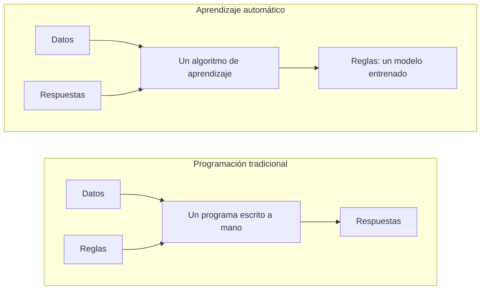

# Paradigmas del aprendizaje automático

El aprendizaje automático permite que los sistemas aprendan de los datos, identifiquen patrones y tomen decisiones con una intervención humana mínima. A diferencia de la programación tradicional, en la que los programas se diseñan con reglas explícitas, el aprendizaje automático construye modelos aprendiendo de los datos.

> [Modelos para entender una realidad caótica | DotCSV](https://www.youtube.com/watch?v=Sb8XVheowVQ) (en español)

Un **modelo** es una descripción abstracta y articulada de una realidad. En aprendizaje automático, los modelos son lo que **entrenamos** con datos mediante un algoritmo de aprendizaje. El modelo aprende a ajustarse a un gran número de ejemplos y después se usa para predecir la respuesta correcta para datos de entrada nuevos que no ha visto.

El vocabulario que se usa durante todo el curso:

- Un **ejemplo** (también *instancia* o *muestra*) es una fila de datos: una casa, un email, una imagen.
- Sus **características** (*features*) son las entradas que ve el modelo: la superficie y la ubicación de la casa, las palabras del email, los píxeles de la imagen.
- El **objetivo** (*target*, o *etiqueta*) es la respuesta que hay que predecir: el precio de la casa, *spam* o *no spam*.
- Los **parámetros** son los números que ajusta el algoritmo de aprendizaje durante el entrenamiento, como los pesos de un modelo lineal. Los **hiperparámetros** son las decisiones que se toman antes del entrenamiento, como cuánto puede crecer en profundidad un árbol.
- El **conjunto de entrenamiento** son los datos de los que aprende el modelo; el **conjunto de test** son datos que se guardan aparte para medir cómo funciona con ejemplos que nunca ha visto.
- La **inferencia** es usar el modelo entrenado para predecir sobre ejemplos nuevos.

La forma en que aprende un modelo la define su paradigma de aprendizaje, que se clasifica según el tipo de supervisión o de feedback que recibe durante el entrenamiento.

> [¿Qué es el Aprendizaje Supervisado y No Supervisado? | DotCSV](https://www.youtube.com/watch?v=oT3arRRB2Cw) (en español)

Los dos paradigmas más habituales, cruzados con el tipo de salida que producen sus tareas principales:

| Salida | Supervisado (ejemplos con sus respuestas) | No supervisado (ejemplos sin respuestas) |
| --- | --- | --- |
| Una categoría | **Clasificación**: a qué clase pertenece un ejemplo | ***Clustering***: en qué grupo de ejemplos parecidos cae |
| Un número | **Regresión**: el valor de un objetivo continuo | **Reducción de dimensionalidad**: coordenadas continuas nuevas, y menos, para cada ejemplo |

En el aprendizaje supervisado la salida es una predicción de un objetivo conocido. El aprendizaje no supervisado no tiene objetivo: su salida es una estructura que el método encuentra en los datos.

Cada tarea de abajo viene con un recuadro que describe una aplicación típica: sus datos, las respuestas que vienen con los datos, qué se aprende y para qué se usa.

## Aprendizaje supervisado

En el aprendizaje supervisado, el conjunto de datos de entrenamiento está **etiquetado con la respuesta correcta**. El algoritmo de aprendizaje recibe un conjunto de datos de entrenamiento y, conociendo la respuesta correcta de cada ejemplo, infiere un modelo que genera esa respuesta. Esto da la vuelta a la programación tradicional: en lugar de escribir las reglas y obtener respuestas, damos los datos y las respuestas, y obtenemos las reglas.

### Clasificación

Una tarea típica de aprendizaje supervisado es la **clasificación**. Piensa en un filtro de spam: un algoritmo puede aprender examinando muchos ejemplos de emails ya etiquetados como «spam» o «no spam». Puede deducir que ciertas palabras casi siempre van asociadas al spam, mientras que los emails de ciertos remitentes nunca son spam. Cuantos más ejemplos etiquetados se usen para entrenar el algoritmo, mejor filtra el spam.

> [!NOTE]
> **Leer dígitos manuscritos**
>
> - **Datos:** imágenes de dígitos manuscritos, cada una una cuadrícula de valores de píxeles
> - **Respuestas dadas:** el dígito, del 0 al 9, escrito en cada imagen
> - **Qué aprende:** a asignar los píxeles de una imagen nueva a uno de los diez dígitos
> - **Se usa para:** leer los códigos postales de las cartas y los importes de los cheques bancarios

Tipos de clasificación:

- **Binaria**: la salida tiene dos clases (p. ej., spam/no spam, positivo/negativo).
- **Multiclase**: la salida tiene más de dos clases (p. ej., reconocimiento de dígitos, clasificación de imágenes).
- **Multietiqueta**: a una instancia se le pueden asignar varias etiquetas (p. ej., etiquetar música con géneros).

### Regresión

En los problemas de **regresión**, el objetivo es predecir un **valor continuo**. Por ejemplo, predecir el precio de una casa a partir de sus características (número de habitaciones, tamaño del jardín, ubicación, etc.). En este caso, en lugar de una etiqueta de clase, cada ejemplo está etiquetado con un valor numérico (el precio de la casa).

> [!NOTE]
> **Valorar una vivienda**
>
> - **Datos:** viviendas que se han vendido, descritas por su superficie, habitaciones, ubicación, antigüedad…
> - **Respuestas dadas:** el precio por el que se vendió cada una
> - **Qué aprende:** cómo depende el precio de esas características, para predecir el precio de cualquier otra vivienda
> - **Se usa para:** las valoraciones automáticas de los portales inmobiliarios, y las comprobaciones que hace un banco antes de conceder una hipoteca

### Dos formas de aprender de los ejemplos

La clasificación y la regresión dicen *qué* predice un modelo. Esta sección trata de otra pregunta: *cómo* usa sus ejemplos para predecir, sea cual sea la tarea. Pasar de ejemplos particulares a una regla general es *inducción*, lo contrario de la *deducción*, que aplica reglas generales a un caso particular. Todo modelo supervisado aprende por inducción, porque tiene que responder para casos que no están entre sus ejemplos. Puede hacerlo de dos formas, y el nombre *aprendizaje inductivo*, en la terminología clásica de la IA, se refiere solo a la primera. Cada forma puede hacer cualquiera de las dos tareas:

| | Clasificación | Regresión |
| --- | --- | --- |
| **Aprendizaje inductivo** | Un filtro de spam aprende qué palabras indican spam, y después busca esas palabras en cada email nuevo | Un modelo aprende cuánto suma cada característica, como la superficie o la ubicación, al precio de una casa, y después las suma para una casa nueva |
| **Razonamiento basado en casos** | Un email nuevo recibe la etiqueta de los emails ya etiquetados más parecidos | Una casa se valora a partir de los precios de las casas más parecidas vendidas cerca |

El **aprendizaje inductivo** construye la regla general explícitamente, por adelantado, durante el entrenamiento, y después responde solo con la regla. Un algoritmo de árbol de decisión, por ejemplo, prueba cada característica con cada umbral, se queda con la pregunta que divide los ejemplos en los dos grupos con respuestas más uniformes, y vuelve a preguntar dentro de cada grupo; después elimina las preguntas que no mejoran sus predicciones para ejemplos apartados del entrenamiento. La regla con la que termina podría haberse programado a mano, pero nadie la escribió: el algoritmo eligió las preguntas y los umbrales a partir de los datos. Es la mitad de aprendizaje automático del diagrama de arriba: entran datos y respuestas, salen reglas. El filtro de spam de antes, el modelo de *scoring* de crédito de un banco aprendido a partir de qué préstamos pasados se devolvieron, y un modelo lineal que predice precios de casas también se inducen, aunque normalmente en muchos pesos en lugar de en unas pocas preguntas. Una regla inducida se ajusta a los ejemplos de los que salió, pero puede seguir fallando en el siguiente caso, y por eso un modelo siempre se juzga con ejemplos que no vio durante el entrenamiento.

> [!NOTE]
> **Clasificar pacientes por riesgo**
>
> - **Datos:** mediciones de pacientes anteriores, tomadas al ingresar en el hospital: edad, tensión arterial, frecuencia cardíaca…
> - **Respuestas dadas:** si cada paciente sobrevivió
> - **Qué aprende:** un árbol de decisión, unas pocas preguntas con umbrales que el algoritmo elige a partir de los datos, como `high_risk = lowest_systolic_pressure <= 91 or (age > 62.5 and sinus_tachycardia)` (riesgo alto si la tensión sistólica mínima es ≤ 91, o si la edad es > 62,5 y hay taquicardia sinusal)
> - **Se usa para:** clasificar a los pacientes nuevos por riesgo, con una regla que los médicos pueden leer y comprobar

El **razonamiento basado en casos** guarda en cambio los ejemplos, como **casos**, y resuelve un problema nuevo a partir de los pasados más parecidos, reutilizando o adaptando sus soluciones. Las personas razonamos así constantemente: un tasador valora un piso a partir de los precios de pisos parecidos vendidos cerca, y un abogado argumenta a partir de las sentencias de casos anteriores parecidos. También muchos sistemas: una tienda que recomienda lo que compraron clientes parecidos, o un asistente que responde una pregunta nueva a partir de las preguntas más parecidas respondidas antes. En IA, es la alternativa a escribir a mano las reglas de los [sistemas expertos](../deep-dives/classical-ai/rules_and_expert_systems.ipynb): los casos son el conocimiento. Su forma más sencilla en aprendizaje automático son los **k vecinos más cercanos** (*k-nearest neighbours*), que se explican en aprendizaje supervisado *(próximamente)*.

Un sistema basado en casos también generaliza: los casos guardados, junto con la forma en que mide la similitud, dan una respuesta para cualquier problema nuevo. Pero esa regla se queda implícita, se calcula de nuevo para cada pregunta y solo a su alrededor, y nunca se escribe.

> [!NOTE]
> **Un servicio de soporte que recuerda**
>
> - **Datos:** tickets de soporte anteriores, cada uno la descripción de un problema
> - **Respuestas dadas:** la solución que resolvió cada ticket
> - **Qué aprende:** nada por adelantado. Para un ticket nuevo, recupera los tickets anteriores más parecidos y reutiliza, o adapta, su solución; una vez resuelto, el ticket nuevo se suma a los casos
> - **Se usa para:** soporte técnico y resolución de incidencias, donde los problemas se repiten pero nadie ha escrito las reglas para resolverlos

## Aprendizaje no supervisado

En el aprendizaje no supervisado, el conjunto de datos de entrenamiento **no está etiquetado**. El objetivo es descubrir patrones ocultos o estructuras intrínsecas en los datos.

*El aprendizaje no supervisado (a) encuentra grupos en ejemplos sin etiquetas; el aprendizaje supervisado (b) aprende una frontera entre clases etiquetadas. Figura: Morimoto y Ponton, [Virtual reality in biology: could we become virtual naturalists?](https://doi.org/10.1186/s12052-021-00147-x), 2021, [CC BY 4.0](https://creativecommons.org/licenses/by/4.0/deed.es).*

### *Clustering*

El ***clustering*** (agrupamiento) consiste en agrupar los puntos de datos en *clusters* según su similitud. Un ejemplo es la segmentación de clientes, en la que los clientes se agrupan en segmentos parecidos para adaptar mejor productos y servicios. Se usa en sistemas de recomendación, marketing y más.

> [!NOTE]
> **Agrupar noticias en historias**
>
> - **Datos:** miles de noticias, cada una descrita por las palabras que usa
> - **Respuestas dadas:** ninguna
> - **Qué aprende:** grupos de noticias que usan palabras parecidas, que suelen contar la misma historia
> - **Se usa para:** los agregadores de noticias, que muestran cada historia una sola vez, con todas las noticias sobre ella

### Minería de reglas de asociación

Mientras que el *clustering* agrupa instancias (como clientes), la **minería de reglas de asociación** descubre relaciones entre artículos. Por ejemplo, identificar que los clientes que compran pan también suelen comprar mantequilla («análisis de la cesta de la compra»).

> [!NOTE]
> **Cestas de la compra**
>
> - **Datos:** los artículos de cada cesta en las cajas de un supermercado
> - **Respuestas dadas:** ninguna
> - **Qué aprende:** reglas como «las cestas con pasta y tomate frito suelen llevar también queso rallado», con la frecuencia con la que se cumple cada una
> - **Se usa para:** colocar los productos en las estanterías, diseñar ofertas y sugerir productos que a menudo se compran juntos

### Reducción de dimensionalidad

La **reducción de dimensionalidad** busca reducir el número de variables (características) de un dataset. Es útil cuando se trabaja con datos de alta dimensionalidad en los que algunas características pueden ser redundantes o irrelevantes. Puede reducir el tiempo de entrenamiento y mejorar la precisión del modelo. Una técnica habitual es el **Análisis de Componentes Principales (PCA)**.

> [!NOTE]
> **Describir caras con unos pocos números**
>
> - **Datos:** fotos de caras; una foto de 100 × 100 píxeles es una lista de 10.000 números
> - **Respuestas dadas:** ninguna
> - **Qué aprende:** con PCA, un pequeño conjunto de *eigenfaces* (caras propias), imágenes fantasmales que captan en qué se diferencian más las caras; cualquier cara se parece mucho a una mezcla ponderada de ellas
> - **Se usa para:** describir cada cara con sus pocos pesos en lugar de con miles de píxeles, lo que hace que las caras sean más rápidas de comparar, guardar y representar

### Detección de anomalías

Esta tarea se centra en identificar puntos de datos o patrones inusuales que se desvían mucho de lo normal. Se usa en la detección de fraude, la monitorización de sistemas y la seguridad para señalar datos que podrían indicar errores o ataques.

> [!NOTE]
> **Detectar un pago con tarjeta inusual**
>
> - **Datos:** los pagos con tarjeta de un cliente: importe, comercio, lugar y hora
> - **Respuestas dadas:** ninguna
> - **Qué aprende:** cómo son los pagos habituales del cliente; un pago muy alejado de ellos se señala
> - **Se usa para:** retener un pago sospechoso hasta que el cliente lo confirme. Los bancos lo combinan con clasificadores entrenados con fraudes conocidos: la detección de anomalías también puede señalar tipos nuevos de fraude, que todavía no describe ninguna etiqueta

## Aprendizaje por refuerzo

En el **aprendizaje por refuerzo**, un **agente** aprende interactuando con un **entorno**. El agente realiza acciones, y el entorno le da feedback en forma de **recompensas** o **penalizaciones**. El objetivo del agente es aprender una **política** (una estrategia para elegir acciones) que maximice su recompensa acumulada a lo largo del tiempo.

Este paradigma se encuentra en la robótica (p. ej., enseñar a andar a un robot) y en los juegos (p. ej., entrenar una IA para jugar al ajedrez o al Go). También es uno de los pasos para convertir un modelo de lenguaje en un asistente de chat: el **aprendizaje por refuerzo a partir de feedback humano (RLHF)** recompensa las respuestas que prefieren las personas.

> [!NOTE]
> **Aprender a jugar a un juego de tablero**
>
> - **Datos:** ninguno de antemano: el agente juega, a menudo millones de partidas contra sí mismo
> - **Respuestas dadas:** ninguna jugada correcta para ninguna posición, solo una recompensa al final de cada partida: ganar o perder
> - **Qué aprende:** una política, qué jugada hacer en cada posición, y qué probabilidad tiene cada posición de acabar en victoria
> - **Se usa para:** juegos como el ajedrez y el Go, donde estos programas ganan a los mejores jugadores humanos, y robots y otros sistemas que actúan paso a paso; [tres en raya con Q-learning](https://github.com/avidaldo/tictactoe-qlearning) lo hace a pequeña escala

> [!NOTE]
> **Convertir un modelo de lenguaje en un asistente**
>
> - **Datos:** preguntas, y varias respuestas a cada una, escritas por el modelo de lenguaje que se está ajustando
> - **Respuestas dadas:** personas ordenan las respuestas de mejor a peor
> - **Qué aprende:** primero un modelo de recompensa que predice qué respuesta prefieren las personas; después el modelo de lenguaje se ajusta, con aprendizaje por refuerzo, para obtener recompensas altas
> - **Se usa para:** asistentes de chat: un modelo ya ajustado con conversaciones de ejemplo aprende a dar las respuestas que prefieren las personas, más útiles y más honestas ([cómo se construye un modelo de lenguaje](language_models.md#cómo-se-construye-un-modelo-de-lenguaje))

## Entre el supervisado y el no supervisado

- El **aprendizaje semisupervisado** usa unos pocos ejemplos etiquetados junto con muchos sin etiquetar, cuando las etiquetas son caras: un médico puede etiquetar cien escáneres, no un millón.
- El **aprendizaje autosupervisado** crea las etiquetas a partir de los propios datos. Un modelo de lenguaje se preentrena ocultando la siguiente palabra de un texto real y aprendiendo a predecirla: cada frase de internet se convierte en un ejemplo etiquetado, sin que ninguna persona etiquete nada. Así es como los grandes modelos de lenguaje actuales aprenden la mayor parte de lo que saben: consulta [los modelos de lenguaje vistos desde fuera](language_models.md).

> [!NOTE]
> **Etiquetar fotos con un modelo** (semisupervisado)
>
> - **Datos:** unos pocos miles de fotos etiquetadas, y millones sin etiquetar
> - **Respuestas dadas:** la clase solo de las fotos etiquetadas
> - **Qué aprende:** un primer modelo, entrenado con las fotos etiquetadas, etiqueta el resto con sus propias predicciones, llamadas *pseudoetiquetas*; después un segundo modelo aprende de todas ellas
> - **Se usa para:** reconocimiento de imágenes y de voz, donde los ejemplos son baratos de recoger y caros de etiquetar
