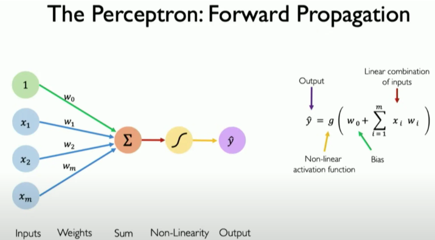
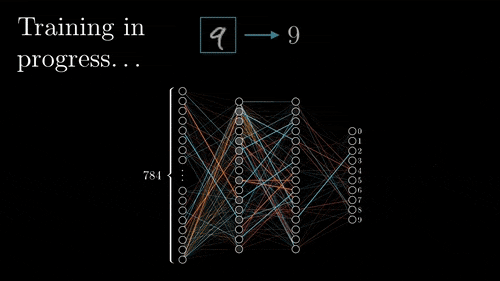
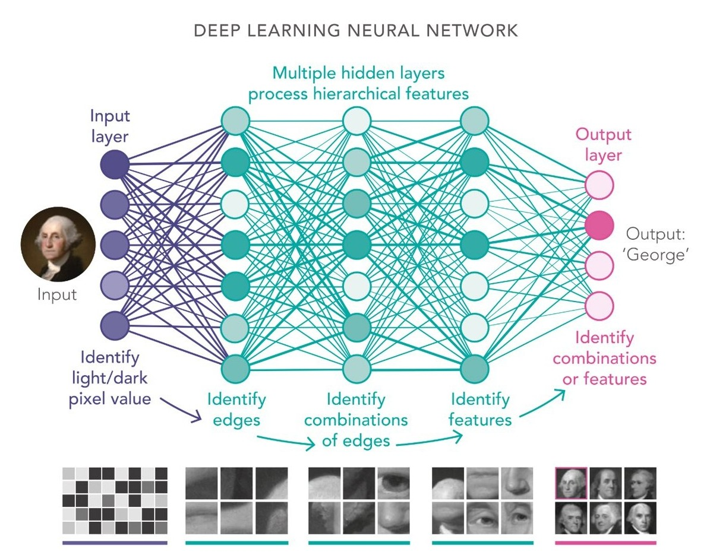

# Las redes neuronales vistas desde fuera

Una **red neuronal** es un modelo construido con muchas unidades sencillas, inspiradas vagamente en las neuronas de un cerebro y conectadas en capas. Es el modelo que hay detrás del **aprendizaje profundo**, y por tanto detrás de la mayoría de los sistemas de imagen, voz y lenguaje de los últimos quince años, [modelos de lenguaje](language_models.md) incluidos. Cómo aprende una red, paso a paso, y cómo construir y entrenar una, se explica en el tema sobre redes neuronales *(próximamente)*.

## Hitos históricos

### Primeros fundamentos (1943–1998)

- 1943: McCulloch y Pitts proponen el primer modelo matemático de una neurona.
- 1958: Frank Rosenblatt desarrolla el **perceptrón**, una neurona modelo que aprende sus pesos a partir de ejemplos.
- 1969: Minsky y Papert publican «Perceptrons», que demuestra las limitaciones del perceptrón simple y contribuye a un largo declive de la investigación en redes neuronales.
- 1980: el **Neocognitrón** de Kunihiko Fukushima, la primera arquitectura convolucional, inspirada en la corteza visual.
- 1986: Rumelhart, Hinton y Williams popularizan la **retropropagación** (*backpropagation*), que **permite entrenar redes neuronales multicapa**. El método en sí tenía raíces anteriores: Seppo Linnainmaa (1970) y Paul Werbos (1974).
- 1989: LeCun et al. entrenan una red convolucional con retropropagación para leer códigos postales manuscritos.
- 1997: Hochreiter y Schmidhuber presentan las **LSTMs** (*Long Short-Term Memory*), fundamentales para procesar secuencias y series temporales.
- 1998: LeCun et al. publican **LeNet-5** y el dataset **MNIST** de dígitos manuscritos.

### El auge de la IA (de 2012 a hoy)

Sus causas, más datos, GPUs y mejores formas de entrenar redes profundas, están en [¿qué es la inteligencia artificial?](what_is_ai.md#una-breve-historia-de-la-ia). Los hitos principales:

- 2012: **AlexNet** (Krizhevsky, Sutskever y Hinton) reduce el error top-5 en **ImageNet** al 15,3 % (desde el 26 %), demostrando la potencia de las CNNs y marcando el inicio del auge.
- 2014: **DeepFace** de Facebook alcanza una precisión casi humana (97,35 %) en reconocimiento facial.
- 2014: Ian Goodfellow presenta las **GANs** (redes generativas adversarias), que revolucionan la generación de contenido.
- 2015: **ResNet**, de Microsoft Research, introduce las conexiones residuales, que permiten entrenar redes de más de 100 capas.
- 2016: **AlphaGo** de DeepMind derrota al campeón del mundo Lee Sedol usando redes neuronales profundas entrenadas con aprendizaje supervisado y por refuerzo, junto con técnicas avanzadas de búsqueda en árbol de Monte Carlo ([documental](https://www.youtube.com/watch?v=WXuK6gekU1Y)).
- 2017: aparece la arquitectura **Transformer** con la publicación de «**Attention is all you need**» de Google Brain, que transforma el procesamiento del lenguaje.
- 2018: **BERT** de Google bate récords en comprensión del lenguaje natural.
- 2020: **GPT-3** de OpenAI demuestra que un modelo de lenguaje lo bastante grande puede hacer una tarea nueva a partir de unos pocos ejemplos escritos en su prompt, sin más entrenamiento.
- 2021–2022: los **modelos de difusión** se imponen en la generación de imágenes: GLIDE de OpenAI (diciembre de 2021), DALL-E 2 y Stable Diffusion (2022). El primer DALL-E (enero de 2021) no era un modelo de difusión, sino un *transformer* que generaba imágenes token a token.
- 2022: **ChatGPT** de OpenAI (GPT-3.5) populariza los asistentes conversacionales.
- 2023: **GPT-4** de OpenAI (marzo), anunciado como un modelo **multimodal** que acepta imágenes además de texto.
- 2024: **GPT-4o** de OpenAI (mayo) maneja texto, imágenes y audio en un mismo modelo, y **o1** (septiembre) es el primero de los modelos de *razonamiento*, que generan una larga cadena de razonamiento antes de responder.
- 2025: **DeepSeek-R1**, un modelo de razonamiento de *pesos abiertos*, obtiene resultados comparables a o1 con un coste mucho menor.

## Qué es una red

> [¿Qué es una Red Neuronal? Parte 1: La Neurona | DotCSV](https://www.youtube.com/watch?v=MRIv2IwFTPg&list=PL-Ogd76BhmcC_E2RjgIIJZd1DQdYHcVf0&index=7) (en español)

> [3Blue1Brown - But what is a neural network?](https://www.youtube.com/watch?v=aircAruvnKk&list=PLZHQObOWTQDNU6R1_67000Dx_ZCJB-3pi) (en inglés)

*Diapositiva del MIT 6.S191, [Introduction to Deep Learning](https://introtodeeplearning.com/), de Alexander Amini.*

Cada unidad, una **neurona artificial**, multiplica cada una de sus entradas por un **peso**, suma los resultados junto con un **sesgo** (*bias*) y pasa la suma por una **función de activación**. Los pesos y los sesgos son los [parámetros](machine_learning_paradigms.md) de la red: los números que ajusta el entrenamiento. La primera unidad de este tipo, el perceptrón, solo podía separar dos clases con una línea recta (un plano, o un hiperplano, con más entradas). Por eso falla en un problema tan pequeño como el XOR: responder 1 cuando exactamente una de dos entradas es 1.

Una **red multicapa** apila unidades en capas: una capa de entrada que recibe los datos, una o más **capas ocultas**, y una capa de salida que da la predicción, una clase o un número. Cada capa oculta combina los patrones encontrados por la capa anterior en otros más complejos, y eso es lo que permite a una red aprender fronteras curvas y relaciones complejas. Solo funciona porque las funciones de activación no son lineales: sin ellas, cualquier número de capas se reduciría a un único modelo lineal.

## Cómo aprende

> [3Blue1Brown - Gradient descent, how neural networks learn](https://www.youtube.com/watch?v=IHZwWFHWa-w&list=PLZHQObOWTQDNU6R1_67000Dx_ZCJB-3pi&index=2) (en inglés)

> [¿Qué es el Descenso del Gradiente? Algoritmo de Inteligencia Artificial | DotCSV](https://www.youtube.com/watch?v=A6FiCDoz8_4) (en español)

El entrenamiento empieza con pesos aleatorios. La red predice para un pequeño lote de ejemplos de entrenamiento, una **función de pérdida** mide lo lejos que están las predicciones de los objetivos, y cada peso se mueve un pequeño paso en la dirección que reduce la pérdida: eso es el **descenso del gradiente**. La **retropropagación** es el algoritmo que calcula esa dirección para todos los pesos a la vez, trabajando hacia atrás desde la capa de salida hasta la de entrada. Repetidos durante muchos lotes, y muchas pasadas por los datos, estos pequeños pasos ajustan la red a sus ejemplos.

El descenso del gradiente se explica paso a paso en aprendizaje supervisado *(próximamente)*, porque los modelos más sencillos también se entrenan con él, y la retropropagación en el tema sobre redes neuronales *(próximamente)*.

## Aprendizaje profundo

El *aprendizaje profundo* (*deep learning*) se refiere a las redes neuronales con muchas capas ocultas (de ahí lo de «profundo»). Sus capas aprenden representaciones de los datos a varios niveles de abstracción: en una imagen, primero bordes, después texturas y formas, después partes de objetos.

Lo que aporta la profundidad:

1. **Características aprendidas a partir de datos en bruto.** En el resto del aprendizaje automático, las personas diseñan las características a mano (*feature engineering*); una red profunda las aprende a partir de los píxeles, el sonido o el texto.
2. **Relaciones complejas en datos no estructurados,** como imágenes, texto y sonido, donde las características hechas a mano se quedan cortas.
3. **Aprendizaje por transferencia.** Lo que una red aprendió en una tarea se puede reutilizar para otra, así que se puede construir un modelo potente con pocos datos.

No siempre merece la pena. Con una tabla de características, como las casas de [valorar una vivienda](machine_learning_paradigms.md#regresión), los árboles con *gradient boosting* son una opción por defecto sólida: a menudo igual de precisos que una red, y más rápidos de entrenar y de ajustar ([Grinsztajn et al., 2022](https://arxiv.org/abs/2207.08815)). Las redes marcan la diferencia cuando las características tienen que aprenderse.

## Familias de redes

| Familia | Los datos a los que se ajusta | Qué hace |
| --- | --- | --- |
| **Redes multicapa** (MLP) | Tablas de características; también una pieza dentro de todas las demás familias | Las capas descritas arriba |
| **Redes convolucionales** (CNN) | Imágenes, y otros datos en forma de cuadrícula | Detectan patrones locales (bordes, texturas, formas) en cualquier parte de la imagen, y los combinan |
| **Redes recurrentes** (RNN, LSTM, GRU) | Secuencias: series temporales, texto | Leen la secuencia en orden, con memoria de lo anterior; para texto, en gran parte sustituidas por los *transformers* |
| ***Transformers*** | Texto, y ahora imágenes y audio | La *atención* compara cada parte de la entrada con todas las demás; casi todos los [modelos de lenguaje](language_models.md) actuales son *transformers* |
| ***Autoencoders*** | Cualquiera | Comprimen los datos en unos pocos números y los reconstruyen; para reducción de dimensionalidad y detección de anomalías |
| **Modelos generativos de imágenes** (GANs, modelos de difusión) | Imágenes, audio | Generan datos nuevos parecidos a los de entrenamiento. Las GANs enfrentan un generador con un discriminador; los modelos de difusión, que aprenden a quitar ruido paso a paso, están detrás de la mayoría de los generadores de imágenes actuales |

Las redes multicapa y convolucionales, y reutilizar una red preentrenada, son el tema sobre redes neuronales *(próximamente)*; los *transformers* son el tema sobre cómo funcionan los modelos de lenguaje *(próximamente)*.
