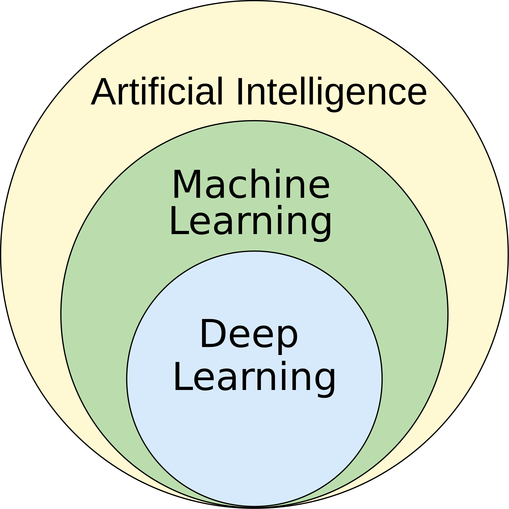

# ¿Qué es la inteligencia artificial? Una introducción histórica y conceptual

## Definir la inteligencia: el empeño por emular la mente humana

La inteligencia artificial (IA) es un campo amplio y ambicioso de la informática dedicado a crear sistemas capaces de realizar tareas que normalmente requieren inteligencia humana. Estas tareas incluyen el razonamiento, el aprendizaje, la resolución de problemas, la percepción, la comprensión del lenguaje e incluso la creatividad.

Algunos investigadores aspiran a máquinas que piensen, aprendan y se adapten tan bien como las personas, o mejor. La mayor parte del trabajo en IA tiene objetivos más acotados: un sistema que hace una tarea, como reconocer voz o recomendar una película, lo bastante bien como para ser útil.

### El test de Turing: una referencia para la inteligencia

En 1950, Alan Turing propuso una prueba sencilla pero potente para medir la capacidad de una máquina de mostrar un comportamiento inteligente equivalente al de un humano, o indistinguible de él. En el **test de Turing**, un evaluador humano mantiene una conversación en lenguaje natural tanto con un humano como con una máquina. Si el evaluador no consigue distinguir de forma fiable la máquina del humano, se dice que la máquina ha superado la prueba.

En 2025, un estudio de la UC San Diego hizo la prueba a tres bandas con conversaciones de texto de cinco minutos: GPT-4.5, al que se le pidió interpretar a un personaje humano, fue considerado el humano el 73 % de las veces, más a menudo que las personas reales ([Jones y Bergen, 2025](https://arxiv.org/abs/2503.23674)). El resultado dice más sobre la prueba que sobre la inteligencia: mide lo convincentemente que un sistema imita a una persona en una conversación, no si entiende o razona.

## Una breve historia de la IA

El sueño de crear seres artificiales es antiguo, pero el recorrido científico de la IA empezó a mediados del siglo XX.

- **1956: el taller de Dartmouth, el nacimiento de un campo**: John McCarthy acuñó el término «Inteligencia Artificial» en la propuesta de 1955 para un taller de verano en el Dartmouth College, celebrado en 1956. El taller reunió a los fundadores del campo y trazó su visión. El optimismo inicial era inmenso, y los pioneros predecían que las máquinas con inteligencia de nivel humano estaban a solo unas décadas.

- **De 1956 a los años 80: la IA simbólica**: durante sus primeras décadas, IA significaba programas que razonan con conocimiento escrito por personas: buscar entre posibilidades, aplicar reglas y sacar conclusiones lógicas. En los años 80, los **sistemas expertos** convirtieron esto en productos, con bases de conocimiento de cientos o miles de reglas si-entonces escritas junto a expertos humanos. La [profundización sobre IA clásica](../deep-dives/classical-ai/README.md) construye un pequeño ejemplo de cada una de estas ideas.

- **Los «inviernos de la IA»: ciclos de expectación y desencanto**: la historia de la IA ha estado marcada por periodos de financiación y entusiasmo intensos («veranos de la IA») seguidos de «inviernos de la IA», en los que el progreso se estancó y la financiación se agotó: el primero a mediados de los 70, el segundo desde finales de los 80, cuando se hundió el mercado de los sistemas expertos. Estos ciclos solían deberse a:
    - **Promesas exageradas**: los primeros investigadores subestimaron la enorme dificultad de tareas como la visión por computador y la comprensión del lenguaje natural.
    - **Límites computacionales**: el hardware de la época no bastaba para manejar la complejidad de los modelos propuestos.
    - **La explosión combinatoria**: muchos enfoques tempranos de IA se basaban en explorar vastos espacios de búsqueda de posibilidades, que se volvían rápidamente intratables computacionalmente.

- **De 2012 a hoy: la revolución del aprendizaje profundo**: el actual «verano de la IA» lo encendió la convergencia de tres factores clave:
    1.  **Big Data**: la disponibilidad de datasets enormes para entrenar modelos complejos.
    2.  **Hardware potente**: el auge de las GPUs (unidades de procesamiento gráfico) aportó la potencia de cálculo en paralelo que necesita el aprendizaje profundo.
    3.  **Mejoras algorítmicas**: la retropropagación, el método que entrena las redes neuronales, es de los años 80; lo que cambió hacia 2012 fueron mejoras prácticas como la activación ReLU y el *dropout*, que permitieron entrenar bien redes mucho más profundas. AlexNet, una red convolucional profunda entrenada en GPUs, ganó por amplio margen la competición de reconocimiento de imágenes ImageNet de 2012.

- **De 2017 a hoy: la IA generativa**: la arquitectura **transformer** (2017) hizo posible entrenar modelos de lenguaje con cantidades enormes de texto. Escalados y después entrenados para seguir instrucciones, se convirtieron en los asistentes de chat que llegaron al público con ChatGPT en noviembre de 2022, y las mismas ideas generan ahora imágenes, audio y código.

El aprendizaje automático ya había desplazado a los sistemas basados en reglas para la mayoría de los problemas desde los años 90; el aprendizaje profundo lo hizo dominante, con sistemas que aprenden directamente de los datos.

## Aprendizaje automático frente a inteligencia artificial

Aunque a menudo se usan como sinónimos, el **aprendizaje automático** (*Machine Learning*, ML) es un subcampo de la IA más fácil de definir. Se centra en construir sistemas que pueden **aprender de los datos**, identificar patrones y tomar decisiones con una intervención humana mínima.

En lugar de programarse explícitamente con reglas para resolver un problema, un modelo de aprendizaje automático **se ajusta a los datos**: un algoritmo de aprendizaje ajusta los parámetros del modelo hasta que capta los patrones que relacionan las entradas con las salidas. Más datos, y mejores, suelen dar un modelo mejor, hasta los límites del propio modelo y de la calidad de los datos.

Un par de definiciones clásicas son:

> [El aprendizaje automático es el] campo de estudio que da a los ordenadores la capacidad de aprender sin ser programados explícitamente.
>
> — Se suele atribuir a Arthur Samuel, que popularizó el término *machine learning* en 1959; la frase es una paráfrasis posterior de su trabajo

> Se dice que un programa de ordenador aprende de la experiencia E con respecto a una clase de tareas T y una medida de rendimiento P si su rendimiento en las tareas de T, medido por P, mejora con la experiencia E.
>
> — Tom Mitchell, 1997

### Aprendizaje profundo

El **aprendizaje profundo** (*Deep Learning*) es un subcampo especializado del aprendizaje automático que usa **redes neuronales artificiales** con muchas capas (de ahí lo de «profundo»). Gracias a estas arquitecturas profundas, estos modelos pueden aprender patrones complejos y jerárquicos a partir de enormes cantidades de datos. Esto ha llevado a grandes avances en campos como la visión por computador y el procesamiento del lenguaje natural.

## El espectro de la IA: de la inteligencia estrecha a la general

Los sistemas de IA se suelen clasificar según lo **generales** que son sus capacidades. Otra distinción, entre IA **débil** y **fuerte**, trata de si una máquina tiene mente; a menudo se confunden las dos.

### IA estrecha

La **Inteligencia Artificial Estrecha** (*Artificial Narrow Intelligence*, ANI) se refiere a sistemas de IA diseñados y entrenados para realizar una **tarea concreta y bien definida**. Es la forma de IA que nos rodea hoy.

- **Características**:
    - **Específica de una tarea**: destaca en un trabajo (p. ej., jugar al ajedrez, reconocer caras, filtrar spam), y no puede trasladar lo que hace a otro.
    - **Basada en datos**: en los sistemas de aprendizaje automático, el rendimiento depende directamente de la calidad y la cantidad de los datos de entrenamiento.

- **Ejemplos**:
    - **Motores de recomendación**: los algoritmos de Netflix o Amazon que sugieren contenido según tu historial.
    - **Filtros de spam y reconocimiento facial**: una tarea cada uno, a menudo hecha mejor que como la hacen las personas.
    - **Coches autónomos**: sistemas muy complejos, pero centrados igualmente en la tarea de conducir.

### IA general (AGI)

La **Inteligencia Artificial General** (*Artificial General Intelligence*, AGI) es la inteligencia hipotética de una máquina capaz de entender, aprender y aplicar su inteligencia a **cualquier tarea intelectual que pueda hacer un ser humano**: razonar, planificar, aprender de la experiencia y trasladar lo que sabe de un dominio a otro sin ser reprogramada.

Los grandes modelos de lenguaje difuminan la línea. Un mismo modelo escribe, traduce, resume, responde preguntas y programa, así que es mucho más general que un filtro de spam; pero sigue fallando en tareas que a una persona le resultan fáciles, y si los modelos actuales son un paso hacia la AGI es una cuestión abierta y muy debatida. Según la mayoría de las definiciones, **la AGI todavía no existe**.

### IA débil e IA fuerte

El filósofo John Searle (1980) distinguió la **IA débil**, máquinas que *simulan* pensar, de la **IA fuerte**, la afirmación de que una máquina programada adecuadamente *tendría* de verdad una mente y entendería. Su argumento de la *habitación china* sostiene que ejecutar un programa, por bien que imite la comprensión, no basta para comprender. La cuestión trata de mentes, no de capacidades, y por eso conviene separar estrecha/general de débil/fuerte.

### Superinteligencia artificial (ASI)

La **Superinteligencia Artificial** (*Artificial Superintelligence*, ASI) es una forma hipotética de IA que supera la inteligencia humana en prácticamente todos los dominios, incluida la creatividad científica, la sabiduría general y las habilidades sociales. El desarrollo de la ASI plantea profundas cuestiones éticas y existenciales para el futuro de la humanidad.
