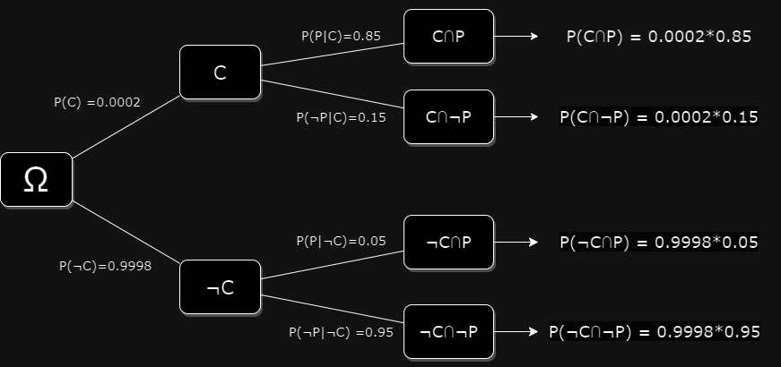

# Bayes' Theorem Applied to a Diagnostic Test

In a population group, 0.02% of people have a certain cancer. A screening test for it is not always right: in people who have the cancer it gives a positive result 85% of the time, and in people who don't, a negative result 95% of the time. Someone tests positive. How probable is it that they have the cancer?

## The Events

- C: the person has cancer; ¬C: the person doesn't.
- T: the test is positive; ¬T: the test is negative.

## What We Know

The probability of having the cancer, before any test, is the disease's **prevalence** in the population, also called the **base rate**:

$$ P(C) = 0.0002 \qquad P(\neg C) = 1 - 0.0002 = 0.9998 $$

A test can fail in two ways, and each has a rate that describes how well the test avoids it:

- A **false negative**: the test is negative although the person has the disease. The test's **sensitivity**, or true positive rate, is the proportion of sick people it detects:

$$ \text{Sensitivity} = P(T|C) = 0.85 \qquad P(\neg T|C) = 1 - 0.85 = 0.15 $$

- A **false positive**: the test is positive although the person doesn't have the disease. The test's **specificity**, or true negative rate, is the proportion of healthy people it correctly clears, and the **false positive rate** is its complement:

$$ \text{Specificity} = P(\neg T|\neg C) = 0.95 \qquad P(T|\neg C) = 1 - 0.95 = 0.05 $$

## The Intuitive Answer, and Why It Is Wrong

The test detects 85% of cancers, so intuition suggests that a positive result means an 85% chance of cancer. That is P(T|C), the probability of a positive test *given* cancer, and the question asks for the reverse, P(C|T), the probability of cancer *given* a positive test. Confusing the two, and so ignoring how rare the disease is, has a name: the **base rate fallacy**.

## The Four Outcomes as a Tree

Each person either has the cancer or doesn't, and then tests either positive or negative. The probability of each of the four outcomes is the product of the probabilities along its path:

Two of the paths end in a positive test: a **true positive**, C ∩ T, and a **false positive**, ¬C ∩ T.

## Bayes' Theorem

[Bayes' theorem](bayes_theorem.md) turns the probability we know, P(T|C), into the one we want, P(C|T):

$$ P(C|T) = \frac{P(T|C) \times P(C)}{P(T)} = \frac{0.85 \times 0.0002}{P(T)} $$

## How Often Is the Test Positive?

The problem doesn't give P(T), the proportion of all tests that come out positive. A positive result is either a true positive or a false positive, and each of these joint probabilities is a conditional probability times the probability of its condition, so by the [law of total probability](probability.md#the-law-of-total-probability):

$$ P(T) = P(T \cap C) + P(T \cap \neg C) = P(T|C) \times P(C) + P(T|\neg C) \times P(\neg C) $$

$$ P(T) = 0.85 \times 0.0002 + 0.05 \times 0.9998 = 0.00017 + 0.04999 = 0.05016 $$

## The Answer

$$ P(C|T) = \frac{P(T|C) \times P(C)}{P(T|C) \times P(C) + P(T|\neg C) \times P(\neg C)} = \frac{0.00017}{0.05016} \approx 0.0034 $$

After a positive test, the probability of having the cancer rises from 0.02% to about 0.34%: about seventeen times higher, and still very unlikely.

## The Same Calculation in People

The reason is easier to see in counts than in probabilities. Out of 100,000 people tested:

| | Test positive | Test negative | Total |
| --- | ---: | ---: | ---: |
| Have the cancer | 17 | 3 | 20 |
| Don't have it | 4,999 | 94,981 | 99,980 |
| Total | 5,016 | 94,984 | 100,000 |

Of the 5,016 people who test positive, only 17 have the cancer: 17 / 5,016 ≈ 0.0034. The test is good, but healthy people are so much more numerous that their 5% of false positives far outnumber the true positives.

A negative result moves the probability the other way: of the 94,984 people who test negative, 3 have the cancer, so P(C|¬T) = 3 / 94,984 ≈ 0.00003.

## How Much the Prevalence Matters

With the same test, a prevalence of 2% instead of 0.02% gives:

$$ P(C|T) = \frac{0.85 \times 0.02}{0.85 \times 0.02 + 0.05 \times 0.98} \approx 0.26 $$

A positive result now means a 26% probability of cancer. Nothing about the test changed, only the group it was used on, and with it the meaning of a positive result. That is why screening programmes target the groups where a disease is more common, and why a model's predictions must be read against how common each class is: the same applies to a spam filter or a fraud detector.

## Further Resources

- [3Blue1Brown: the medical test paradox, and redesigning Bayes' rule](https://www.youtube.com/watch?v=lG4VkPoG3ko)
- [Veritasium: the Bayesian trap](https://www.youtube.com/watch?v=R13BD8qKeTg) ([dubbed into Spanish](https://www.youtube.com/watch?v=D7KKlC0LOyw))
- [Matemáticas con Juan: a similar problem, solved](https://www.youtube.com/watch?v=n11NDXIIcLI) (in Spanish)
- [Base rate fallacy](https://en.wikipedia.org/wiki/Base_rate_fallacy)
