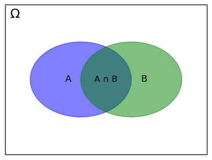

# Probability

**Probability** measures how certain an event is, as a number between 0 (impossible) and 1 (certain), often written as a percentage. If the probability of an event A is P(A), the probability that it doesn't happen is P(¬A) = 1 − P(A).

## The Frequentist Interpretation

For a frequentist, the probability of an event is the proportion of times it happens when an experiment is repeated many times. A fair die shows a 6 with probability 1/6 because, over many throws, about one throw in six is a 6. Probability is a property of the repeatable experiment, not of anyone's knowledge.

Machine learning uses this view whenever it estimates a probability by counting: the share of spam among the emails of a training set, or the error rate of a model on a test set. Classical statistics, with its hypothesis tests and confidence intervals, is built on it.

## The Bayesian Interpretation

For a Bayesian, a probability is a **degree of belief** about something uncertain, which need not be repeatable: the probability that it will rain tomorrow, or that a given patient has a disease. A belief starts as a **prior** and is updated into a **posterior** as evidence arrives, with [Bayes' theorem](bayes_theorem.md). A forecast of tomorrow's rain, for example, combines how often it rains at this time of year with today's measurements of pressure and humidity.

This view is the basis of the Bayesian networks used in diagnosis ([reasoning under uncertainty](../classical-ai/uncertainty.ipynb)), of spam filters that update their beliefs with every new email, and of methods that report how uncertain a prediction is, not just the prediction.

Both views use the same mathematics. They differ in what a probability means.

## Conditional Probability

The probability of an event A **given** that an event B has happened is written P(A|B): for example, the probability that a patient has a disease given that a test is positive.

Knowing that B happened shrinks the world of possibilities, the **sample space** Ω, to the outcomes in B. Within it, A happens only where both happen, in A ∩ B:

$$ P(A|B) = \frac{P(A \cap B)}{P(B)}, \quad \text{with } P(B) > 0 $$

Rearranged, it gives the probability that both events happen:

$$ P(A \cap B) = P(A|B) \times P(B) $$

## The Law of Total Probability

An event B happens either together with A or together with ¬A, never both. Its probability is therefore the sum of the two cases:

$$ P(B) = P(B \cap A) + P(B \cap \neg A) = P(B|A) \times P(A) + P(B|\neg A) \times P(\neg A) $$

The [diagnostic test](diagnostic_test.md) uses it to find how often a test is positive at all.

## Sources

- [What is probability? (Machine Learning Mastery)](https://machinelearningmastery.com/what-is-probability/)
- [Conditional probability, University of Washington CSE 312](https://courses.cs.washington.edu/courses/cse312/18wi/312A/lecture7.pdf)
- [Conditional probability explained visually](https://setosa.io/ev/conditional-probability/)
